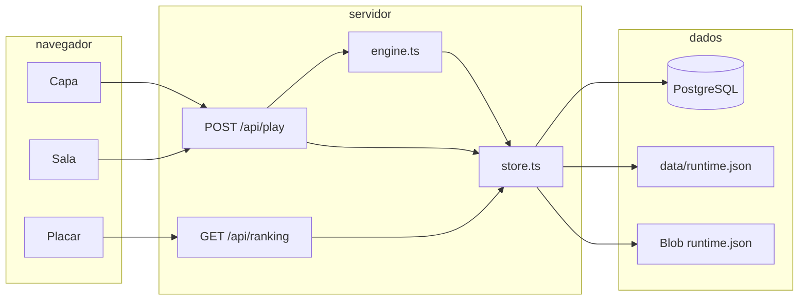

# Arquitetura e banco de dados

Este documento descreve como o Sombras do Contágio está montado: o que cada pasta faz, como uma jogada atravessa a interface até o motor, onde o catálogo e as partidas ficam gravados, e o que cada tabela ou campo significa.

O jogo é um simulador de gestão. A regra do dia, a curva da Apatia e o fim da partida rodam no servidor. O navegador só mostra a sala e envia a ação escolhida. O conteúdo — bairros, políticas, boletins, parâmetros e fórmulas — não está espalhado pelo componente da tela. Ele entra como um catálogo, que pode viver em PostgreSQL, num arquivo local ou num Blob privado, com a mesma forma lógica.

## 1. Visão geral

Há quatro blocos.

| Bloco | Onde está | Papel |
| --- | --- | --- |
| Interface | `src/app`, `src/components` | Capa, sala, placar e editor. Não calcula a epidemia. |
| API | `src/app/api` | Recebe a jogada, lê e grava o repositório, devolve a visão da partida. |
| Motor | `src/lib/engine.ts`, `src/lib/formula.ts`, `src/lib/validate.ts` | Aplica a ação, avança um dia e monta o que a tela pode mostrar. |
| Persistência | `src/lib/store.ts`, `db/schema.sql`, `data/runtime.json` ou Blob | Guarda o catálogo, as partidas e o placar. |

O catálogo de partida nasce em TypeScript, em `src/content`. `seedCatalog()` clona esse objeto e recusa a carga se a validação falhar. PostgreSQL só recebe essa carga quando a tabela `parameters` está vazia. O arquivo e o Blob fazem o mesmo na primeira leitura, se ainda não existir nada gravado.



Uma instância do servidor escolhe um único modo e o mantém pelo resto do processo. A ordem está em `getRepo()`:

1. Se existe `DATABASE_URL`, tenta criar o schema e usar PostgreSQL.
2. Se a conexão falha, registra o erro e segue no modo arquivo.
3. O modo arquivo, por sua vez, grava no Blob privado quando `VERCEL` e `BLOB_READ_WRITE_TOKEN` estão definidos. Fora da Vercel, grava em `data/runtime.json`.

O site publicado não depende de PostgreSQL. O disco da função some entre invocações, então a mesma estrutura do arquivo local vai para o Blob. A capa não informa qual desses modos está ativo.

## 2. Pastas

```text
src/app                rotas da interface e da API
src/components         capa, sala, mapa, placar, editor, ícones
src/content            catálogo que semeia o banco
src/lib                motor, tipos, repositório, fórmulas, validação
db/schema.sql          tabelas, criadas com IF NOT EXISTS
db/seed.sql            INSERTs do mesmo catálogo, para inspeção ou carga manual
scripts/simulate.ts    partidas automáticas de conferência
scripts/export-sql.ts  regenera db/seed.sql a partir de src/content
data/runtime.json      arquivo local; não entra no Git
```

`npm run dev` sobe o Next.js. `npm run sim` roda o motor sem navegador. `npm run export:sql` regrava `db/seed.sql` quando parâmetros, políticas, eventos ou lições mudam no código. O schema não muda nesse comando.

## 3. Interface

O App Router entrega quatro telas.

| Rota | Componente | O que faz |
| --- | --- | --- |
| `/` | `Inicio` | Pede o nome, de 2 a 24 caracteres, e uma das quatro datas de 2026. |
| `/jogo?partida=` | `Sala` | Lê a partida e manda cada ação. |
| `/ranking` | `Placar` | Lista até 50 gestões encerradas. |
| `/admin` | `Admin` | Editor do catálogo. Não há link na capa. |

A sala tem três abas. Sala mostra o mapa de Maricá e as facções. Gestão lista as medidas, em quatro famílias. News junta boletim, registro e o último desfecho. Um boletim, uma notificação ou uma novidade nova abre um aviso no papel da sala. Se o caso ainda estiver pendente, o aviso espera a escolha.

O cliente guarda só o que precisa para desenhar a tela: qual aba está aberta, o texto de erro e a fila de avisos. O estado verdadeiro da epidemia volta do servidor em cada resposta, no objeto `view`.

As quatro entradas do calendário estão em `src/lib/starts.ts` e não são linhas do banco. São 1º de fevereiro, 18 de maio, 1º de agosto e 15 de dezembro de 2026. A data da partida é uma string `AAAA-MM-DD`, tratada ao meio-dia UTC para o fuso não mudar o dia.

## 4. Uma jogada, de ponta a ponta

Toda ação de jogo é um `POST /api/play` com JSON. O corpo traz `action` e, conforme o caso, `id`, `playerName`, `startId`, `policyId` ou `choiceId`.

| `action` | Efeito |
| --- | --- |
| `create` | Abre uma partida nova e devolve a visão. |
| `load` | Lê a partida sem alterar o estado. |
| `toggle` | Liga ou desliga uma medida sustentada. |
| `instant` | Executa uma medida de uso único ou limitado. |
| `choose` | Responde o boletim pendente. |
| `end` | Fecha o dia, se não houver boletim aberto. |

`create` normaliza o nome: NFKC, espaços colapsados, entre 2 e 24 caracteres, sem caracteres de controle. O identificador da partida é um UUID. O estado inicial coloca 22 infectados no Centro e 6 em Itaipuaçu, zera a pesquisa, lê verba, leitos e cobertura vacinal dos parâmetros, e abre o evento marcado como `opening`. No catálogo de partida esse evento é `caso-zero`.

As outras ações exigem `id`. Se a partida não existe, a resposta é 404. `load` não grava. As demais passam por `applyAction`. Se a ação é inválida, a API devolve 400 e a visão do estado antigo, sem gravar a tentativa.

Quando a ação vale, `publish` compara o estado anterior com o novo. Se a partida saiu de `playing` e ainda não foi para o placar, grava uma linha de ranking e marca `ranked`. Em seguida grava a partida inteira e devolve `buildView`.

O placar público é `GET /api/ranking`. A resposta traz a lista e também o modo do repositório (`postgres`, `arquivo` ou `blob`). `GET /api/health` só responde `{ ok: true }` ou `{ ok: false }`. Não devolve contagens nem o modo de armazenamento.

O editor usa `GET` e `POST /api/admin`, com a chave no cabeçalho `x-admin-key`. A comparação é em tempo constante. A chave é só `ADMIN_KEY` do ambiente, com pelo menos 12 caracteres. Sem isso, toda chamada é recusada. Não existe chave embutida no código. `POST` aceita o catálogo novo ou `{ action: "reset" }`, que repõe `seedCatalog()` e não apaga partidas nem placar. O `POST` valida de novo no servidor. `src/app/robots.ts` pede que `/admin` e `/api/admin` fiquem fora dos índices.

## 5. Motor

Três funções são a borda do motor.

`createInitialState` monta o `GameState`. `applyAction` clona o estado, confere a ação e executa uma delas: ligar medida, usar medida instantânea, escolher resposta ou fechar o dia. `buildView` projeta os números que a tela mostra e esconde o que o jogador não deve ler, como a semente aleatória e o mapa interno de eventos já disparados.

O estado é clonado antes de mudar. Uma ação recusada não altera a partida gravada.

### 5.1 O que a tela recebe

`GameView` é uma leitura. Traz data, medidores, bairros com casos, políticas com o motivo de estarem bloqueadas, o boletim pendente sem revelar o efeito de cada escolha, o último desfecho, o relatório da noite, o registro, os modificadores ainda em curso, o codex e as dicas. A ordem pública já vem calculada. A receita e a manutenção do dia também.

O boletim pendente lista só o texto e se a escolha cabe na verba. O resultado e a lição aparecem depois, em `lastOutcome`.

### 5.2 Projeção

`project` não avança o dia. Soma infectados, recuperados e óbitos, estima leitos da Apatia pela gravidade e pela idade de cada recorte, soma a pressão de arbovirose ou SRAG conforme o mês, aplica capacidade extra e o corte de greve, e então chama as fórmulas `occupancy` e `income`. A ordem pública é a média das facções ponderada por `weight`.

Essa projeção serve à tela, aos gatilhos e ao próprio fechamento do dia. Por isso um número mostrado de manhã e o número usado à noite partem da mesma conta.

### 5.3 Fechar o dia

`resolveDay` segue esta ordem.

1. Suspende medidas sustentadas cuja manutenção diária a receita não cobre.
2. Soma a receita e desconta a manutenção. A verba não fica negativa.
3. Para cada recorte, calcula importação dos vizinhos, o fator local e a força de infecção. Casos novos usam a fórmula `newInfections` e um arredondamento estocástico. A recuperação diária é a fração `recovery` dos infectados.
4. Reparte os óbitos do dia entre quem teve leito e quem ficou de fora, pela fórmula `deaths`. O excesso sem leito entra no total mesmo quando não cabe mais no recorte.
5. Sorteia até duas viagens de ônibus. A chance sobe com os infectados da origem, cai com a quarentena e pode ser barrada numa entrada com barreira. O caso é somado no destino. Não é subtraído da origem.
6. Com chance de 11%, uma ambulância sai do hospital do Centro para uma UPA ou um posto. Soma 6 leitos por um modificador de 4 dias, dos quais restam 3 depois do desconto da mesma noite.
7. Move o apoio das três facções: desgaste ou recuperação da saúde conforme a ocupação, recuperação do comércio sem quarentena relevante, e o efeito dos óbitos do dia sobre a população.
8. Avança a pesquisa pela fórmula `research`, limitada a 100.
9. Desconta um dia dos modificadores temporários e descarta os que zeraram.
10. Atualiza as sequências de superlotação e de desordem, grava o relatório e o histórico, e chama `conclude`.
11. Se a partida continua, soma um dia no calendário e escolhe no máximo um boletim para a manhã seguinte.

O histórico guarda no máximo 180 pontos. O registro cresce com o texto de cada noite e de cada escolha.

`conclude` encerra a partida, nesta precedência: pesquisa em 100% é vitória; ocupação acima de 100% por `overloadDays` seguidos é derrota; ordem abaixo de `disorderThreshold` por `disorderDays` seguidos é derrota; óbitos sobre a população em `deathCollapseRatio` ou mais é derrota. A pontuação usa a fórmula `score`. O placar, porém, ordena primeiro por dias, depois por vitória, depois por essa pontuação e por fim por menos óbitos.

### 5.4 Aleatoriedade

Cada partida tem `rngState`, semeado pelo id, pelo nome e pela data de entrada. `nextRandom` avança essa semente. A mesma sequência de ações, no mesmo catálogo, reproduz os mesmos sorteios. Não há `Math.random` no fechamento do dia.

### 5.5 Efeitos

Políticas, escolhas e modificadores carregam um `EffectBag`. As chaves aceitas estão em `EFFECT_KEYS`, em `src/lib/types.ts`. Algumas valem na hora, como verba, leitos permanentes, pesquisa imediata, infectados plantados num recorte ou óbitos. Outras duram enquanto a medida está ligada ou enquanto `durationDays` não acaba: pesquisa diária, renda, taxa de contato, proteção, quarentena, barreiras, turismo, mobilidade, fechamento de escolas, risco de idosos, aglomeração, passaporte e leitos de campanha.

`durationDays` transforma o pacote num modificador temporário. Sem essa chave, o efeito instantâneo entra no estado e o efeito contínuo fica ligado à política ativa.

Há grupos exclusivos. No catálogo de partida, `pesquisa-basica` e `pesquisa-intensiva` compartilham o grupo `pesquisa` e não ficam ligadas juntas.

## 6. Catálogo

O tipo `Catalog` junta oito listas.

| Lista no código | Tabela | O que guarda |
| --- | --- | --- |
| `districts` | `districts` | Oito recortes, população, marcas e o desenho SVG. |
| `factions` | `factions` | Comerciantes, profissionais de saúde e população civil. |
| `policies` | `policies` | Medidas instantâneas ou sustentadas. |
| `events` | `events` | Boletins, janela de calendário, gatilho e escolhas. |
| `lessons` | `lessons` | Oito textos fixos do codex. |
| `tips` | `tips` | Avisos disparados por métrica, sem sorteio. |
| `parameters` | `parameters` | Números nomeados que o motor lê por chave. |
| `formulas` | `formulas` | Sete expressões que o motor avalia por id. |

O catálogo de partida, em `src/content`, tem 8 recortes, 3 facções, 19 políticas, 17 eventos, 8 lições, 5 dicas, 45 parâmetros e 7 fórmulas. Um editor pode incluir ou tirar linhas. O motor não presume a quantidade, com uma exceção: as sete fórmulas de `REQUIRED_FORMULAS` precisam existir, porque o dia as chama pelo id.

### 6.1 Recortes

Cada recorte tem `id`, nome, distrito oficial, população, e cinco marcas de 0 a 1: `elderly`, `tourism`, `commerce`, `schools` e `border`. `neighbors` é a lista de ids ligados por contato. `path`, `labelX` e `labelY` desenham o mapa. A população somada no catálogo de partida é 212.703.

Os ids são `inoa`, `sao-jose`, `centro`, `cordeirinho`, `aracatiba`, `barra`, `itaipuacu` e `ponta-negra`.

As facções de partida começam em 72, 74 e 70, com pesos 0,30, 0,35 e 0,35.

### 6.2 Políticas

`kind` é `instant` ou `sustained`. `cost` é o gasto ao executar. `dailyCost` é a manutenção de uma medida ligada. `cooldownDays` e `maxUses` limitam a repetição. `exclusiveGroup` impede duas medidas do mesmo grupo. `effects` é um JSON com o pacote de efeitos.

As famílias da tela são o campo `category`: `saude`, `fronteiras`, `pesquisa` e `faccoes`.

### 6.3 Eventos

Um evento tem prioridade, texto, lição, janela opcional de mês e dia, `repeatable`, `cooldown` e `trigger`. `opening` marca o boletim da primeira manhã. As escolhas ficam num JSON: id, rótulo, desfecho, lição e efeitos. A prioridade menor ganha quando mais de um evento cabe no mesmo dia. O desempate é o título em português.

O gatilho é uma destas formas.

| `type` | Significado |
| --- | --- |
| `calendar` | A janela de mês e dia já filtrada. Pode ter `chance`. |
| `random` | Sorteio diário com `chance` entre 0 e 1. |
| `metric` | Compara uma métrica com `gt`, `lt`, `gte` ou `lte`. |
| `all` | Todas as condições internas precisam valer. |

Métricas aceitas: `day`, `occupancy`, `order`, `vaccine`, `research`, `deathsToday`, `quarantine`, `passport`, `gathering`, `infected`, `faction.comerciantes`, `faction.saude`, `faction.civil`.

Uma dica pode usar métrica, calendário ou `all`. Não pode usar `random`.

### 6.4 Parâmetros que o dia lê direto

Além das fórmulas, o motor lê parâmetros pelo nome. Os principais são a taxa de contato `beta`, a recuperação, a gravidade, a letalidade com e sem leito, a receita de base, a pesquisa espontânea, a importação entre vizinhos, a verba e os leitos iniciais, a cobertura vacinal, as máscaras de mês da arbovirose e da SRAG, os limiares de colapso, de greve, de revolta e de pânico, e os pesos da pontuação.

`arbovirusMask` e `sragMask` são máscaras de bits. Janeiro vale 1, fevereiro 2, março 4, e assim por diante até dezembro valer 2048. O valor 2063 cobre janeiro a abril e dezembro. O valor 224 cobre junho, julho e agosto.

## 7. Banco relacional

`db/schema.sql` é aplicado inteiro na primeira conexão com `DATABASE_URL`. Cada comando já traz `IF NOT EXISTS`, então subir de novo não apaga dados. Se `parameters` está vazia, `writeCatalog` grava o catálogo semeado.

O pool tem no máximo cinco clientes. Fora de `localhost` e `127.0.0.1`, a conexão usa SSL com `rejectUnauthorized: false`, o ajuste comum dos provedores gerenciados.

Não há migrações versionadas. Mudar uma coluna exige editar `schema.sql` e aplicar o `ALTER` à mão num banco que já existe. O `ensureSchema` não altera tabela criada.

### 7.1 Tabelas de conteúdo

O nome no TypeScript está em camelCase. A coluna está em snake_case. JSONB guarda lista ou objeto.

`districts`

| Coluna | Origem | Notas |
| --- | --- | --- |
| `id` | `id` | Chave primária, texto. |
| `name` | `name` | |
| `official_district` | `officialDistrict` | |
| `population` | `population` | Inteiro. |
| `elderly`, `tourism`, `commerce`, `schools`, `border` | os mesmos nomes | `double precision`. |
| `neighbors` | `neighbors` | JSONB, array de ids. |
| `svg_path` | `path` | |
| `label_x`, `label_y` | `labelX`, `labelY` | |

`factions`: `id`, `name`, `description`, `weight`, `start_value`. O campo no código chama-se `start`.

`policies`: `id`, `name`, `category`, `summary`, `lesson`, `kind`, `cost`, `daily_cost`, `cooldown_days`, `max_uses`, `exclusive_group`, `effects`. `max_uses` e `exclusive_group` podem ser nulos.

`events`: `id`, `title`, `category`, `priority`, `opening`, `body`, `lesson`, `month_start`, `month_end`, `day_start`, `day_end`, `repeatable`, `cooldown`, `trigger`, `choices`. Mês e dia podem ser nulos. `trigger` e `choices` são JSONB.

`lessons`: `id`, `title`, `topic`, `body`.

`tips`: `id`, `text`, `trigger`.

`parameters`: `key` é a chave primária. `value` é o número. `label` e `hint` explicam o parâmetro no editor.

`formulas`: `id`, `label`, `expression`, `explanation`.

Não há chave estrangeira entre evento e bairro, nem entre política e facção. O vínculo é o texto do id. `validateCatalog` recusa id repetido, efeito desconhecido, facção ou bairro citado que não exista, métrica fora da lista e fórmula que o avaliador não consegue ler.

Gravar o catálogo abre uma transação, apaga as oito tabelas de conteúdo e insere de novo. `saves` e `ranking` ficam de fora desse apagamento. Uma partida antiga continua com o estado que tinha. Os nomes e os números que ela passa a ler vêm do catálogo novo. Se uma política ou um bairro sumir, a partida que ainda aponta para esse id fica sem aquele pedaço.

### 7.2 Partidas

`saves` guarda uma linha por partida.

| Coluna | Uso |
| --- | --- |
| `id` | UUID da partida. |
| `player_name` | Nome do placar. |
| `status` | `playing`, `won` ou `lost`. |
| `days_survived` | Cópia de `state.day`. |
| `research` | Cópia de `state.research`. |
| `state` | O `GameState` inteiro, em JSONB. |
| `created_at`, `updated_at` | Preenchidos pelo banco. A atualização refresca `updated_at`. |

O motor não consulta as colunas soltas para simular. Elas existem para achar a partida e para uma leitura rápida. A autoridade é `state`.

O objeto dentro de `state` tem, entre outros campos:

| Campo | Papel |
| --- | --- |
| `startId`, `day`, `date` | Entrada escolhida, dia da gestão e data civil. |
| `budget`, `capacity`, `research`, `vaccineCoverage` | Fundo, leitos de base, cura e cobertura de rotina. |
| `factions` | Mapa do id da facção para um valor de 0 a 100. |
| `districts` | Por recorte: `infected`, `recovered`, `dead`. |
| `activePolicies` | Ids das medidas sustentadas ligadas. |
| `timedModifiers` | Efeitos com `daysLeft`. |
| `fired` | Último dia em que cada evento disparou. |
| `policyUses`, `cooldowns` | Usos e espera das medidas. |
| `pendingEventId` | Boletim que trava o fim do dia. |
| `lastOutcome`, `lastReport`, `log`, `codexExtra` | O que a aba News e o codex mostram. |
| `overloadStreak`, `disorderStreak` | Dias seguidos no limiar de derrota. |
| `deathsToday`, `totalDead`, `history` | Óbitos e a curva recente. |
| `status`, `endingTitle`, `endingText`, `score`, `ranked` | Fim da partida e se já entrou no placar. |
| `rngState` | Semente. Não vai para a visão. |

### 7.3 Placar

`ranking` tem `id`, `save_id` único referenciando `saves(id)`, `player_name`, `days_survived`, `research`, `dead`, `score`, `outcome`, `ending_title` e `created_at`.

`save_id` único impede duas linhas para a mesma partida. O `INSERT` usa `ON CONFLICT (save_id) DO NOTHING`. O índice `ranking_days_idx` cobre dias e pontuação. A consulta do placar ordena por dias, vitória, pontuação e menos óbitos, e limita a 50.

`outcome` no banco é `won` ou `lost`. O estado da partida usa `status` com o valor extra `playing`, que nunca entra no placar.

## 8. Arquivo e Blob

Sem PostgreSQL, ou quando a conexão falha, o repositório é um único JSON:

```json
{
  "catalog": {},
  "games": {},
  "ranking": []
}
```

`catalog` é o mesmo `Catalog` do TypeScript, em camelCase, não no formato das colunas. `games` é um mapa do id da partida para o `GameState`. `ranking` é a lista de entradas.

No computador isso é `data/runtime.json`. O arquivo está fora do Git. Se falta ou se o JSON está quebrado, o servidor cria um catálogo novo, sem partidas. Um catálogo presente porém inválido interrompe a leitura em vez de ser substituído em silêncio.

Na Vercel, com o token do Blob, o pathname é `runtime.json`, acesso privado, sem sufixo aleatório, com sobrescrita. A leitura pede `useCache: false`. Se o objeto não existe, a primeira chamada semeia o catálogo.

Leituras e escritas do arquivo ou do Blob passam por uma fila dentro do processo, para duas jogadas ao mesmo tempo não gravarem uma por cima da outra pela metade. Essa fila não atravessa instâncias. Duas funções serverless podem ler o mesmo JSON e a última escrita ganha. PostgreSQL não tem esse recorte: cada `saveGame` é um `INSERT ... ON CONFLICT` daquela partida.

## 9. Fórmulas

`src/lib/formula.ts` avalia a expressão guardada em `formulas.expression`. A linguagem aceita números, os nomes que o motor passar naquela chamada, parênteses, `+`, `-`, `*` e `/`, e as funções `exp`, `abs`, `sqrt`, `round`, `min`, `max` e `clamp`. Não há atribuição, chamada arbitrária nem acesso a arquivo.

As sete expressões de partida são:

| Id | Expressão | Variáveis que o motor entrega |
| --- | --- | --- |
| `force` | `infectedShare * beta * factor + imported` | prevalência local, taxa de contato, fator do recorte, importação |
| `newInfections` | `susceptible * (1 - exp(-1 * force))` | suscetíveis e a força já calculada |
| `deaths` | `treated * max(0, baseLethality + lethalityShift) + untreated * overloadLethality` | leito, excesso e o deslocamento de letalidade |
| `income` | `baseIncome * (1 - quarantineWeight * quarantine) + incomeExtra` | quarentena acumulada e bônus de renda |
| `research` | `researchBase + researchDaily` | avanço das políticas de pesquisa |
| `occupancy` | `(apatiaBeds + parallelBeds) / capacity` | leitos da Apatia, das outras síndromes e capacidade efetiva |
| `score` | `days * scorePerDay + research * scorePerResearch + winBonus - dead * scorePerDeath` | dia, pesquisa, bônus de vitória e óbitos |

`baseLethality`, `overloadLethality`, `baseIncome`, `quarantineWeight`, `researchBase` e os pesos da pontuação vêm dos parâmetros e entram na expressão como nomes. Trocar o número do parâmetro muda o tamanho do termo. Trocar o texto da expressão muda a conta. Os dois caminhos passam pela validação antes de gravar.

O fator do recorte, a importação entre vizinhos, o ônibus e a ambulância não estão nessas sete strings. Estão em `engine.ts`, com limiares lidos dos parâmetros.

## 10. O que fica de fora do banco

Entram no código, não numa tabela:

- as quatro datas de entrada, em `src/lib/starts.ts`;
- o desenho dos municípios vizinhos e o contorno usado pelo mapa, em `src/content/geography.ts`;
- o hospital, as UPAs e os postos da ambulância, em `src/content/health.ts`;
- a ordem do fechamento do dia, a semente e as regras de vitória e derrota, em `src/lib/engine.ts`;
- a lista de chaves de efeito e de métricas, em `src/lib/types.ts` e `src/lib/validate.ts`.

Um boletim novo, com texto, gatilho e escolhas, cabe no catálogo. Uma regra nova, como um terceiro meio de transporte, pede mudança no motor.

## 11. Como alterar o conteúdo com segurança

1. Prefira o editor quando `ADMIN_KEY` estiver definida no ambiente. Ele valida antes de gravar e o próximo turno já lê o catálogo novo.
2. Para mudar a semente que um banco vazio recebe, edite `src/content` e rode `npm run export:sql` se quiser o `db/seed.sql` alinhado. Um PostgreSQL que já tem parâmetros não é reescrito sozinho. Use o reset do editor, que repõe o catálogo e preserva partidas e placar, ou aplique o SQL à mão.
3. Não apague um id que partidas em andamento ainda usam, a menos que a intenção seja deixar essa medida ou esse recorte fora do cálculo.
4. Mantenha as sete fórmulas obrigatórias e os ids das três facções se os gatilhos de métrica `faction.comerciantes`, `faction.saude` e `faction.civil` continuarem no catálogo.
5. `npm run sim` percorre gestões automáticas contra o catálogo do código. Serve para ver se uma mudança de parâmetro ainda deixa a omissão perder cedo e a gestão atenta alcançar a cura.

## 12. Limites desta persistência

O schema não versiona alterações de coluna. O Blob e o arquivo serializam o banco inteiro a cada jogada e podem perder uma escrita concorrente entre instâncias. O PostgreSQL grava a partida de forma atômica, mas o catálogo é substituído por completo, não por linha editada. A visão enviada ao navegador é calculada na hora. Ela não é uma tabela.

Nada disso muda a regra de leitura: uma jogada passa pela API, o motor decide, e o repositório escolhido na subida do processo é quem guarda o resultado.
